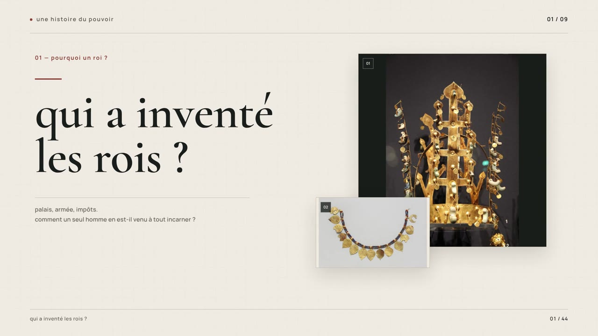

# qui a inventé les rois ?

Documentaire en motion graphics réalisé à partir des dix voix off françaises fournies : **16:9, Full HD 1920 × 1080, 30 images/s, environ 3 min 56 s**.

[Télécharger la vidéo MP4](https://github.com/mbairamadji007/starter/raw/refs/heads/main/videos/royaute-documentaire.mp4)

Le montage comprend 44 plans, des photographies historiques, de véritables vidéos d’illustration, une carte schématique et des diagrammes animés. Les textes à l’écran sont en minuscules, avec Cormorant Garamond et Manrope. La narration garde son ordre et son débit ; les longues zones de silence ont été raccourcies. Musique et effets sonores originaux accompagnent la voix.

## projet modifiable

- [Télécharger le projet complet en ZIP](https://github.com/mbairamadji007/starter/archive/refs/heads/royaute-documentaire-source-v1.zip)
- [Parcourir les sources et les instructions HyperFrames](https://github.com/mbairamadji007/starter/tree/royaute-documentaire-source-v1)
- [Crédits, auteurs, sources et licences des images et vidéos](https://github.com/mbairamadji007/starter/blob/royaute-documentaire-source-v1/CREDITS.md)

Le projet inclut les médias locaux, les polices, le mix audio et les pistes séparées. Après extraction : `npm ci`, puis `npm run preview` ou `npm run render`. Les prérequis et options du navigateur sont dans son README.

Conserver les crédits avec toute diffusion du film. Les photographies contemporaines, les paysages filmés et les objets d’autres périodes sont contextualisés comme illustrations, sans les présenter comme des archives filmées de la première royauté.
